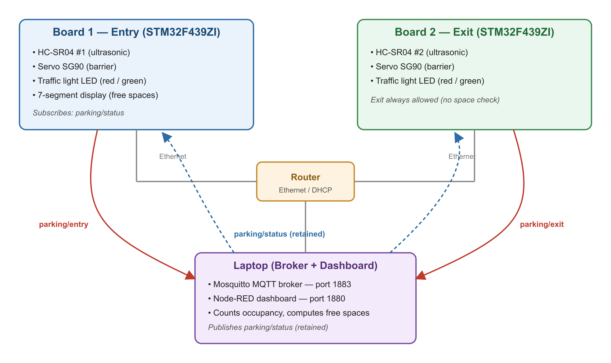

# Smart Parking System: Distributed Embedded System with STM32 and MQTT

A distributed parking garage controller built from two **STM32F439ZI** boards and a laptop, communicating over **Ethernet and MQTT**. Each board runs one barrier: an ultrasonic sensor detects arriving cars, a servo opens the barrier, and a traffic light shows the gate state. A Node-RED dashboard on the laptop counts free spaces and pushes the current status back to the boards.

Team project for the course *Distributed Systems* at HTWG Konstanz (summer 2026).



## Features

- **Two independent barrier nodes** (entry and exit), each on its own STM32 board
- **Car detection** with an HC-SR04 ultrasonic sensor (arrival and completed pass-through), debounced in software
- **Servo barrier** driven by 50 Hz hardware PWM via direct timer register access
- **Entry control:** the entry barrier only opens while free spaces are available
- **Retained MQTT status:** a board that reboots knows the current number of free spaces immediately after reconnecting
- **Last Will messages** so the dashboard shows when a board goes offline
- **Self-healing:** automatic reconnect plus an independent hardware watchdog (IWDG)
- **7-segment display** on the entry board showing the free spaces
- **Node-RED dashboard** that counts entries/exits and publishes the status

## Tech stack

| Area | Technologies |
|---|---|
| Hardware | 2x STM32F439ZI Nucleo-144, HC-SR04, SG90 servo, LEDs, 7-segment display |
| Firmware | C, FreeRTOS (CMSIS v2), STM32 HAL, STM32CubeIDE |
| Networking | LwIP 2.1.2 (TCP/IP, DHCP), coreMQTT, Ethernet (RMII, LAN8742A) |
| Backend | Mosquitto MQTT broker, Node-RED dashboard |

## System overview

```
Board 1 (entry)                                   Board 2 (exit)
HC-SR04 -> logic -> servo + traffic light         HC-SR04 -> logic -> servo + traffic light
        \                                                 /
         \---------- Ethernet / MQTT ---- Router ---------/
                                   |
                         Laptop: Mosquitto + Node-RED
                   (counts cars, publishes free spaces)
```

### MQTT topics

| Topic | Publisher | Subscriber | Payload |
|---|---|---|---|
| `parking/entry` | Board 1 | Node-RED | `{"event":"entry"}` after a car has passed |
| `parking/exit` | Board 2 | Node-RED | `{"event":"exit"}` after a car has passed |
| `parking/status` (retained) | Node-RED | Board 1, dashboard | `{"free":4,"total":5}` |
| `status/board1`, `status/board2` | Boards (Last Will) | Dashboard | `online` / `offline` |

### Entry sequence (Board 1)

1. The ultrasonic sensor detects a car (distance below 10 cm, 3 consecutive readings).
2. The board checks the cached number of free spaces from `parking/status`.
3. If a space is free, the barrier opens and the light turns green; otherwise it stays closed and red.
4. When the car has passed, the light turns red, the board publishes `parking/entry` and closes the barrier.
5. Node-RED decrements the free spaces and publishes the new retained status.

The exit board follows the same sequence without the space check.

## Firmware architecture

The firmware on both boards uses a layered architecture instead of a monolithic `main.c`:

| Layer | Files | Responsibility |
|---|---|---|
| Application | `mqtt_task.c`, `parking_sensor.c` | Parking logic, state handling, what to publish and when |
| Service | `service/mqtt_service.c` | MQTT connect, publish, subscribe, message callback (wraps coreMQTT) |
| Driver | `driver/mqtt_transport.c`, `servo.c`, `hcsr04.c`, `ampel.c`, `seg7.c` | TCP transport over LwIP, sensor and actuator drivers |
| Platform | HAL, LwIP, FreeRTOS, coreMQTT | Generated by STM32CubeMX / third party |

More details, including the hardware wiring and the problems solved during development, are in [docs/ARCHITECTURE.md](docs/ARCHITECTURE.md).

## Repository structure

```
Board1/            STM32CubeIDE project for the entry barrier
Board2/            STM32CubeIDE project for the exit barrier
Shared/            Configuration shared by both boards (broker IP and port)
NodeRED/           Node-RED flow (counting logic and dashboard)
docs/              Architecture notes and test results
mosquitto.conf     Broker configuration for the demo network
```

## Getting started

**Requirements:** STM32CubeIDE, Mosquitto, Node-RED with `node-red-dashboard`, two Nucleo-F439ZI boards and a router with DHCP.

1. **Import the projects:** In STM32CubeIDE choose *File > Import > Existing Projects into Workspace* and import `Board1` and `Board2`.
2. **Set the broker IP:** Enter the IP of the laptop running Mosquitto in `Shared/mqtt_config.h`. It applies to both boards.
3. **Build and flash** both boards. If both are connected via USB, select the correct ST-Link serial number in the run configuration.
4. **Start the broker:** `mosquitto -v -c mosquitto.conf` and allow TCP port 1883 in the firewall.
5. **Start Node-RED,** import `NodeRED/parking_flow.json` and deploy. The dashboard runs at `http://localhost:1880/ui`.

The boards obtain an IP via DHCP and connect to the broker automatically.

## Testing

The system was tested for normal operation, edge cases (full garage, cold start, counter limits), robustness (broker restart, cable unplugged, long-term run) and latency. See [docs/TESTING.md](docs/TESTING.md) for the results.

## Documentation

- [Architecture and lessons learned](docs/ARCHITECTURE.md)
- [Test results](docs/TESTING.md)

## Team

Ruben Kaiser, Lukas Rank
